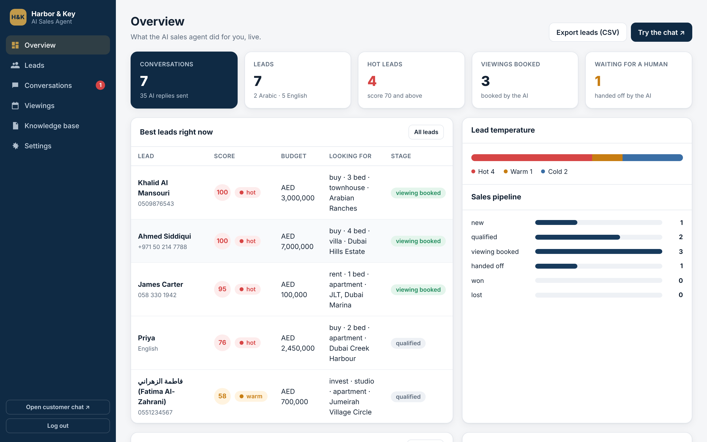
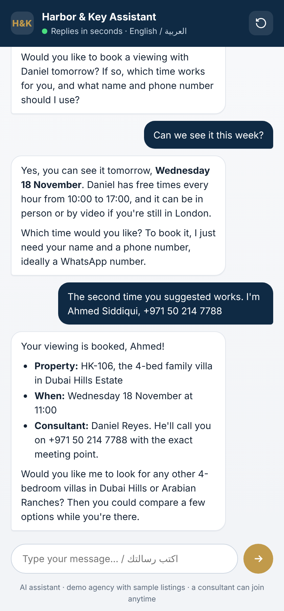
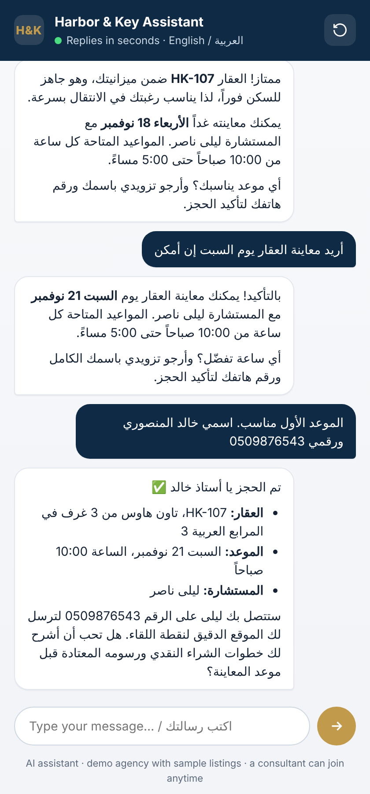
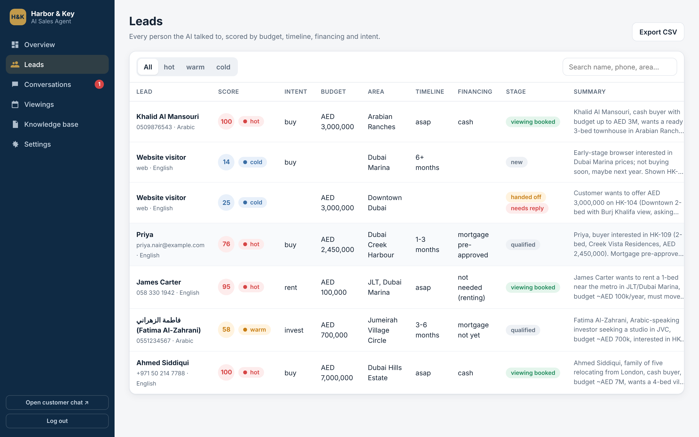
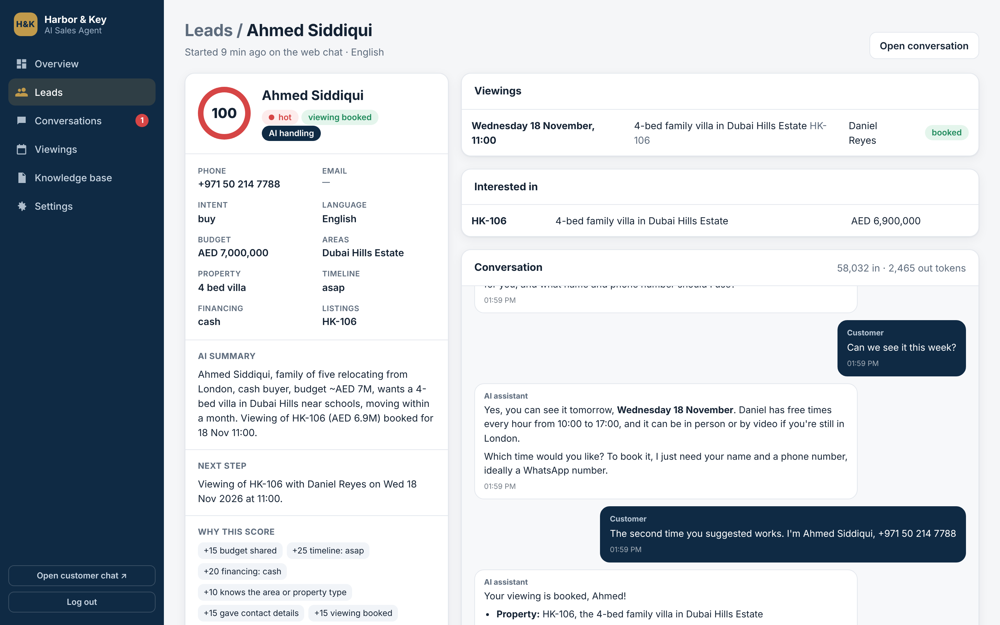
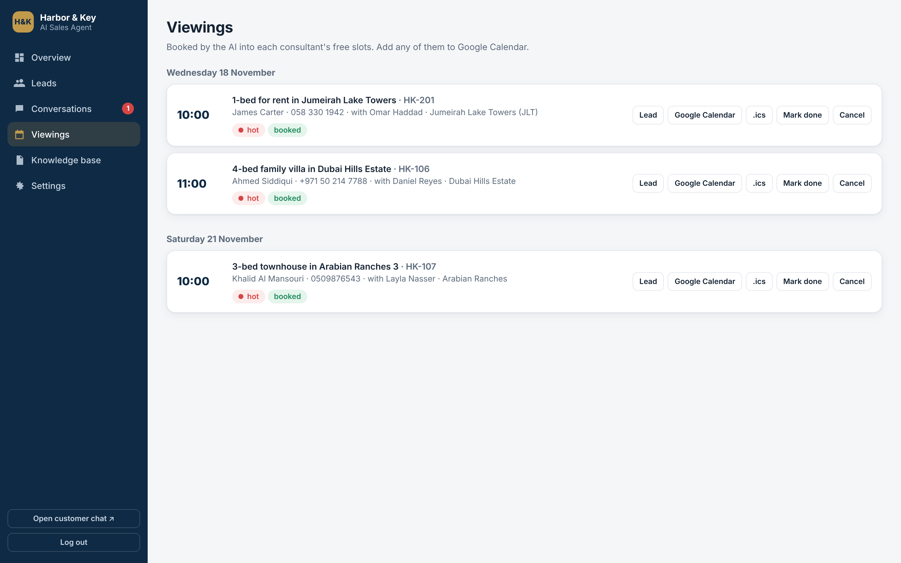
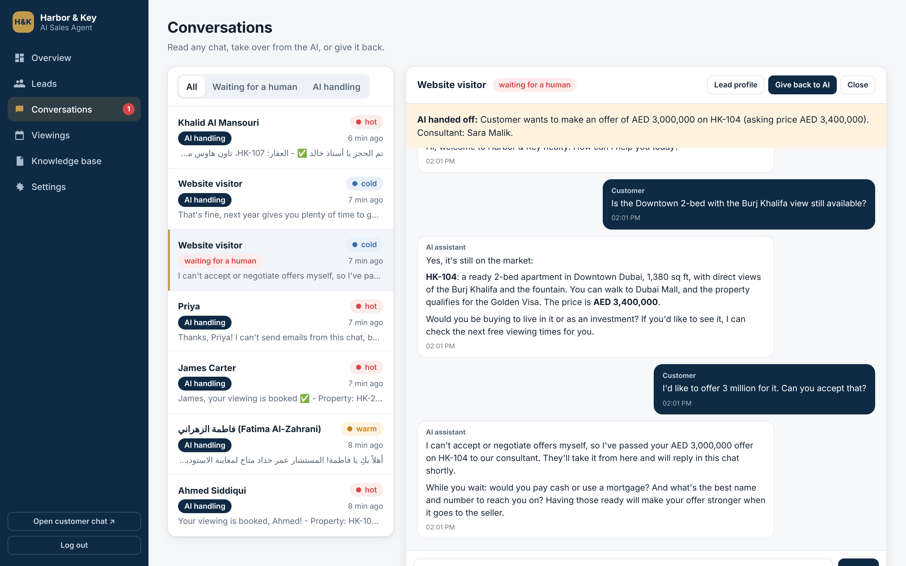
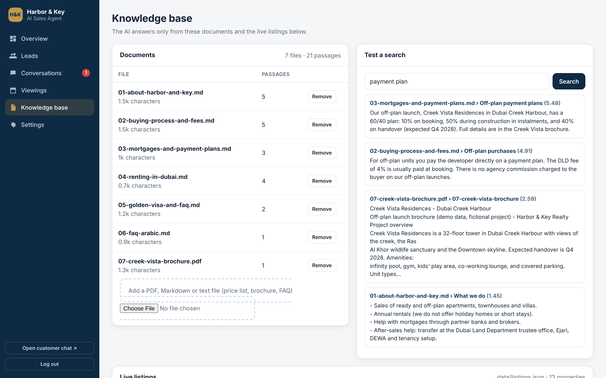
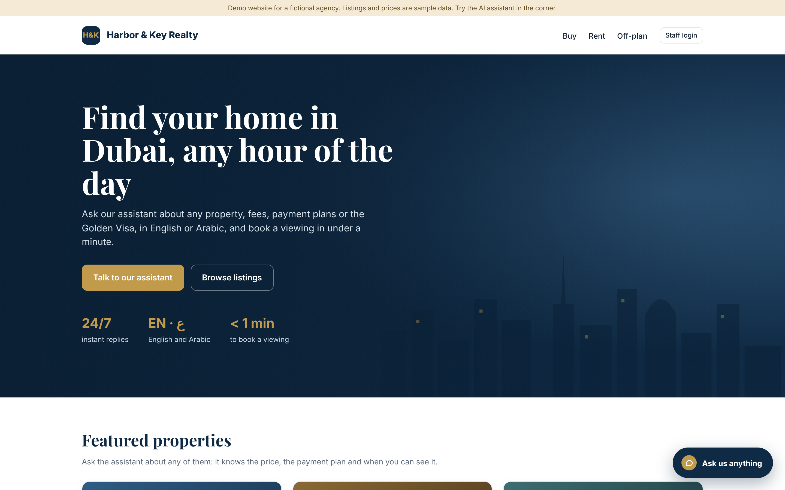

# AI Sales Agent for Real Estate (Demo)

An AI sales agent for a real estate agency. It chats with buyers and tenants in **English and Arabic**, answers from the agency's **own documents and listings**, **qualifies and scores every lead** (hot, warm or cold), **books property viewings** into each consultant's calendar, and **hands the chat to a human** when it should. The sales team sees everything on a **staff dashboard**.

Built with **Claude (Anthropic API)**, **LangGraph**, **FastAPI** and **SQLite**. It runs on any laptop with one command.

> Harbor & Key Realty is a fictional Dubai agency. All listings, prices and people are sample data.



## What it does

| | |
|---|---|
| **Answers from your documents** | Reads PDFs, Markdown and text files (price lists, brochures, FAQs, fees) and answers only from them. Prices come from structured listings, so they are never made up. |
| **English and Arabic** | Replies in the customer's language. The sales summary is always in English for the team. |
| **Qualifies every lead** | Asks naturally about intent, area, budget, timeline and financing, one or two questions at a time, and saves each answer to the CRM as it goes. |
| **Transparent lead score** | 0 to 100 from clear rules (budget, timeline, financing, contact details, viewing booked), with the reasons shown. Hot from 70, warm from 40. |
| **Books viewings** | Offers the consultant's real free slots (Mon to Sat, 10:00 to 18:00), books the one the customer picks, and adds a Google Calendar link and an `.ics` file. |
| **Human handoff** | Price negotiation, offers, complaints, or "can I talk to a person" go to a consultant. Staff reply from the dashboard, and can give the chat back to the AI, which reads what was said meanwhile. |
| **Sends leads anywhere** | Every lead, booking and handoff can be POSTed to an n8n, Make or Zapier webhook (Google Sheets, HubSpot, GoHighLevel...). CSV export is built in. |
| **Staff dashboard** | Overview, leads with scores, lead profiles, live conversations, viewing calendar, knowledge base upload and search, settings. |

## Screenshots

These come from real conversations with the agent (see [Recorded demo](#recorded-demo)).

| Customer chat (English) | Customer chat (Arabic) |
|---|---|
|  |  |

| Leads with scores | Lead profile |
|---|---|
|  |  |

| Viewings booked by the AI | Human handoff |
|---|---|
|  |  |

| Knowledge base | Agency website with the chat widget |
|---|---|
|  |  |

## How it works

```
Customer (web chat / WhatsApp)
        │
        ▼
FastAPI  ──►  LangGraph loop  ──►  Claude (tool use)
                    ▲                    │ calls tools
                    │                    ▼
                    └──── tool results ◄── search_knowledge   (BM25 over your PDFs and docs)
                                           search_listings    (structured listings, real prices)
                                           update_lead        (CRM + rule-based score)
                                           get_viewing_slots / book_viewing
                                           handoff_to_human
        │
        ▼
SQLite (conversations, leads, viewings)  ──►  Staff dashboard  ──►  optional webhook (n8n / Sheets / CRM)
```

- **`app/agent.py`**: the LangGraph graph (`call_claude` → `run_tools` → back, until Claude answers). The full Claude history is stored per conversation and only appended to, so prompt caching keeps each turn cheap.
- **`app/tools.py`**: the 6 tools and their Python handlers.
- **`app/knowledge.py`**: document reading (PDF, Markdown, text), chunking and BM25 search. No vector database or embedding key is needed; swap in Supabase pgvector for very large document sets.
- **`app/scoring.py`**: lead scoring rules in one place.
- **`app/scheduling.py`**: consultant calendars, free slots, Google Calendar links and `.ics`.
- **`web/`**: the demo agency website, the chat widget and the dashboard (plain HTML, CSS and JavaScript, no build step).

## Run it

You need Python 3.11+ and a Claude API key from [console.anthropic.com](https://console.anthropic.com).

**Windows:** double-click `run.bat`. **Mac or Linux:** `./run.sh`.

Or by hand:

```bash
python -m venv .venv
.venv\Scripts\activate          # Mac/Linux: source .venv/bin/activate
pip install -r requirements.txt
copy .env.example .env          # Mac/Linux: cp .env.example .env
# open .env and paste your ANTHROPIC_API_KEY
python run.py
```

Then open:
- **http://localhost:8000**: the agency website. Click **Ask us anything** and chat.
- **http://localhost:8000/dashboard**: the staff dashboard (password from `ADMIN_PASSWORD`, default `demo1234`).

## Recorded demo

`scripts/demo_conversations.py` runs 7 realistic customers (a family buying a villa, an Arabic-speaking investor, a tenant, an off-plan buyer, someone who wants to negotiate, a browser, an Arabic townhouse buyer) through the real agent, and saves the result to `demo/demo-data.json`.

To see a full dashboard **without an API key**, load that recording:

```bash
python scripts/demo_data.py load
python run.py
```

## Make it yours

- Put your own documents in `knowledge/` (PDF, `.md`, `.txt`), or upload them on the Knowledge base page.
- Put your listings in `data/listings.json`.
- Set `AGENCY_NAME`, `AGENCY_CITY` and `AGENCY_TIMEZONE` in `.env`.
- Change the scoring weights in `app/scoring.py`.
- Set `LEAD_WEBHOOK_URL` to an n8n or Make webhook to push leads into Google Sheets or your CRM.

### WhatsApp

The agent is channel-independent: `agent.handle_customer_message(conversation_id, text)` returns the reply. To connect the WhatsApp Business Cloud API, add a webhook route that maps each phone number to a conversation, calls that function, and sends the reply back through the WhatsApp API.

## Tests

```bash
pip install -r requirements-dev.txt
python -m pytest -q
```

The tests use a fake Claude client, so they run offline and cost nothing. They cover a full sales conversation (listings → qualification → booking → hot lead), handoff and staff takeover, AI errors falling back to a human, the login, and the scoring rules.

## Cost

Claude Opus 5.5 at `low` effort with prompt caching. A typical 5-message sales chat uses a few cents of API credit. Token use per conversation is shown on the dashboard.

## License

MIT. Built by Abubakar Inam, Fik Creations.
